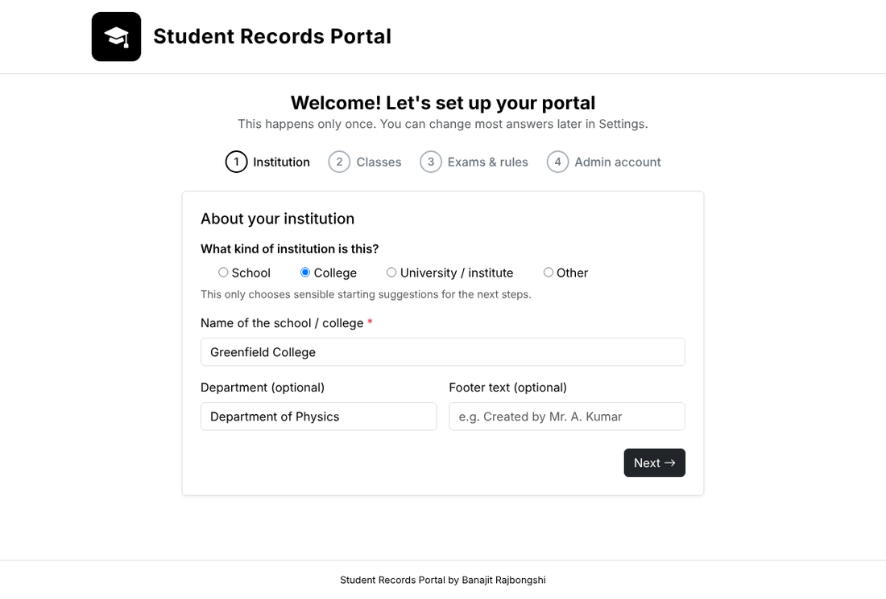
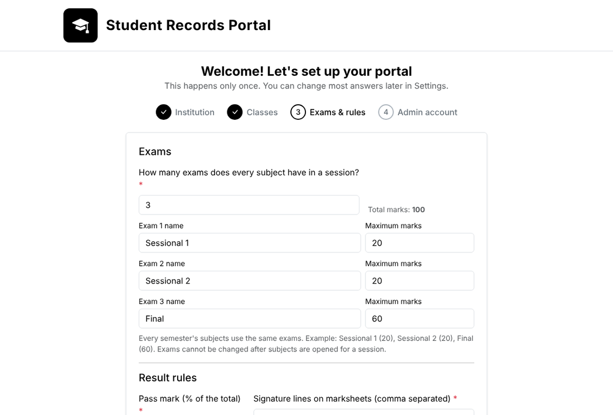
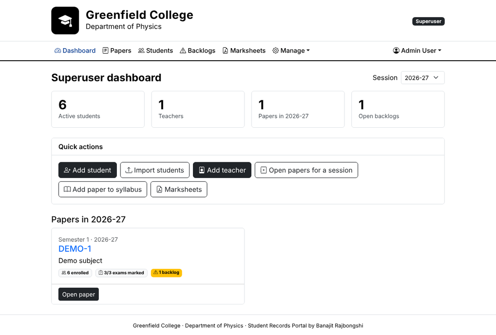
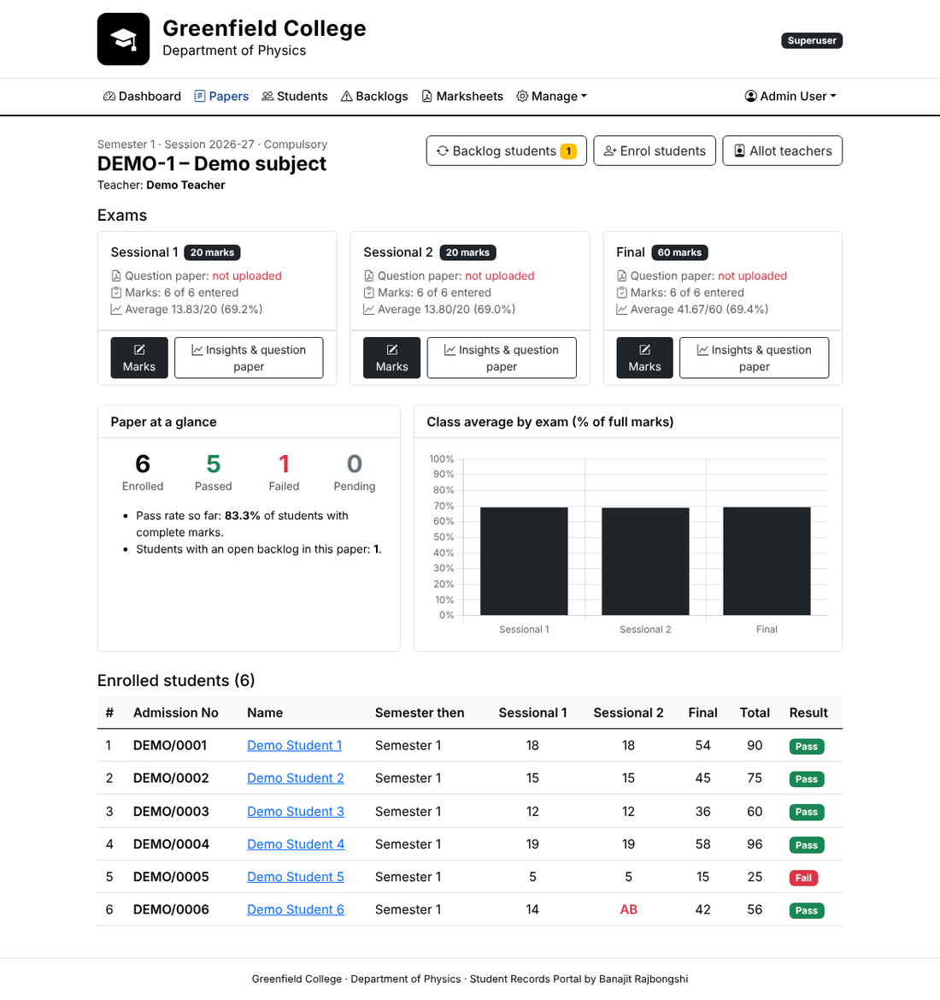
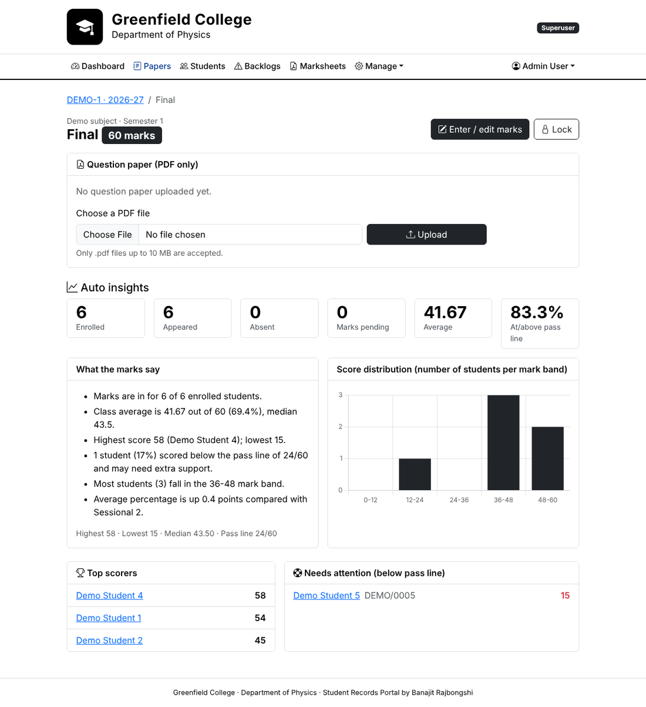

# Student Records Portal

A simple, self-hosted web app for **schools and colleges** to keep student records, enter exam marks, store question papers,
track backlogs and print marksheets. Built with Django and Bootstrap. It runs on one ordinary PC (or a small server), needs
no internet connection, and is configured by a **one-time setup wizard**, so the same app works for a school with
Classes 1-10 and for a college with semesters.

> Created by **Banajit Rajbongshi** &middot; MIT licensed

| Setup wizard | Exams & rules |
|---|---|
|  |  |
| **Dashboard** | **Subject / paper page** |
|  |  |



## What it does

* **First-run setup wizard** asks once for: school/college name (and optional department, footer text), what you call a
  class (*Class, Semester, Year...*) and a subject (*Subject, Paper, Course...*), the list of classes, **how many exams** every
  subject has in a session and the **maximum marks of each**, the **pass mark**, optional letter grades / divisions, and creates
  your administrator login. Logo, labels and rules can be edited later in **Settings**.
* **Superuser (administrator) is supreme**: adds students and teachers, manages classes and subjects, opens subjects for a
  session, allots teachers, enrols students, locks exams, edits any mark, prints marksheets, reads the audit log.
* **Teachers** log in and see only the subjects allotted to them and the students enrolled in each. For every exam they can
  upload the **question paper (PDF only)**, enter marks (AB = absent) and read **auto insights**: average, highest/lowest,
  pass rate, score bands, top scorers, students who need support, and a comparison with the previous exam.
* **Student profile in one click**: every subject taken, the session, and the class the student was in at that time.
* **Backlogs**: when all exams of a subject have marks, students below the pass mark are marked backlog. Next session they are
  added to the subject's exams in one click (or "Add all"); passing the re-attempt clears the backlog automatically.
* **Marksheets (PDF)**: one class for all students in a single PDF, one student's class sheet, or a student's complete
  record across every class. Backlog attempts are shown separately and are not counted in the totals.
* **Import** students from CSV / Excel (admission number is the unique identity) and subjects from CSV / Excel.
* Mark changes are logged (who, what, when). Uploaded question papers are only visible to logged-in users allowed on that subject.

## Quick start

Requires **Python 3.10+**.

```bash
git clone https://github.com/<your-user>/student-records-portal.git
cd student-records-portal

python3 -m venv venv                       # Windows: python -m venv venv
./venv/bin/pip install -r requirements.txt # Windows: venv\Scripts\pip install -r requirements.txt
./venv/bin/python manage.py migrate
./run.sh                                   # Windows: run.bat
```

Open **http://localhost:8000** on the same computer. You are taken straight to the setup wizard (4 short steps).
When it finishes you are logged in as the administrator. Other computers on the network can then use
`http://<IP-of-this-computer>:8000`.

> For safety the wizard only opens from the computer that runs the portal (`localhost`). To install on a hosting service,
> start it with the environment variable `PORTAL_SETUP_ANYWHERE=1` and finish the wizard immediately.

Prefer the command line? `python manage.py setup_site --help` does the same setup without the browser, e.g.

```bash
python manage.py setup_site --type school --name "Sunrise Public School" --prefix Class --count 10 \
  --exams "Half Yearly:50,Annual:50" --pass-percent 35 --admin-username admin --admin-password 'Choose-a-strong-one'
```

`python manage.py seed_demo` adds a small **fake** data set (1 teacher, 6 students) to try everything. Delete it before real use.

## Everyday use

1. **Teachers**: Manage -> Teachers -> *Add teacher* (they can change their password after logging in).
2. **Subjects**: *Manage -> subject list -> Add* one by one, or **Import list** (CSV/Excel with `Class, Code, Name, Credits, Compulsory`).
   See [`examples/`](examples) for ready-made lists. Compulsory subjects enrol the whole class automatically; optional ones are enrolled by hand.
3. **Students**: *Add student* or **Import students** (CSV/Excel with `Admission No, Student Name, ...`).
4. **Each session**: Dashboard -> *Open subjects for a session* -> choose session (e.g. `2026-27`) and class, tick the subjects,
   pick a teacher for each.
5. **Teachers**: log in -> open a subject -> *Marks* / *Insights & question paper* for each exam.
6. **Marksheets** (administrator) when marks are complete. Next year: move students to the next class (edit student) and open the new session.

## Settings and rules

* **Settings page** (administrator): name, department, footer, **logo** (PNG/JPG), labels, pass mark, grade table, division table,
  marksheet signature lines. A single class can have its own pass mark (Classes page).
* The **exams** (names and marks) are fixed once the first subject is opened for a session, because marks belong to them.
* Pass rule: the total of all exams of a subject must reach the pass mark. Grade and division tables are only *starting suggestions*:
  **set them to your board / university rules**. SGPA is shown only when subjects have credits and grades are switched on.
* `config/settings.py` holds technical options (time zone, upload limits, `SHOW_SOFTWARE_CREDIT`, ...).

## Deploying beyond one PC

The default setup (`runserver`, SQLite) is meant for a single office PC or LAN. For a public server use a real WSGI server
(gunicorn / waitress), HTTPS, and set:

| Environment variable | Purpose |
|---|---|
| `DJANGO_SECRET_KEY` | Your own secret key (otherwise one is generated into `.secret_key`) |
| `DJANGO_ALLOWED_HOSTS` | Comma separated host names, e.g. `records.myschool.org` |
| `DJANGO_CSRF_TRUSTED_ORIGINS` | e.g. `https://records.myschool.org` |
| `DJANGO_DEBUG` | Leave unset (off) in production |
| `PORTAL_SETUP_ANYWHERE` | `1` only while running the setup wizard remotely |

## Backup and privacy

```bash
python manage.py backup_db      # database + uploaded question papers -> backups/
```

Everything lives in `db.sqlite3` and `media/`. Copy `backups/` somewhere safe regularly. The database contains personal data
(dates of birth, phone numbers): keep the computer password protected and **never commit** `db.sqlite3`, `.secret_key`, `media/`
or class lists to a public repository (they are already in `.gitignore`).

## Tests

```bash
python manage.py test portal
```

## Project layout

```
config/          Django settings and URLs
portal/          the app: models, views, services (results & insights), pdf, importers, templates, static
portal/static/   Bootstrap, Bootstrap Icons, Chart.js (bundled, works offline)
examples/        sample subject lists (CSV) to import
docs/            screenshots
```

## License

MIT - see [LICENSE](LICENSE). Bundled front-end libraries: see [THIRD_PARTY_NOTICES.md](THIRD_PARTY_NOTICES.md).
